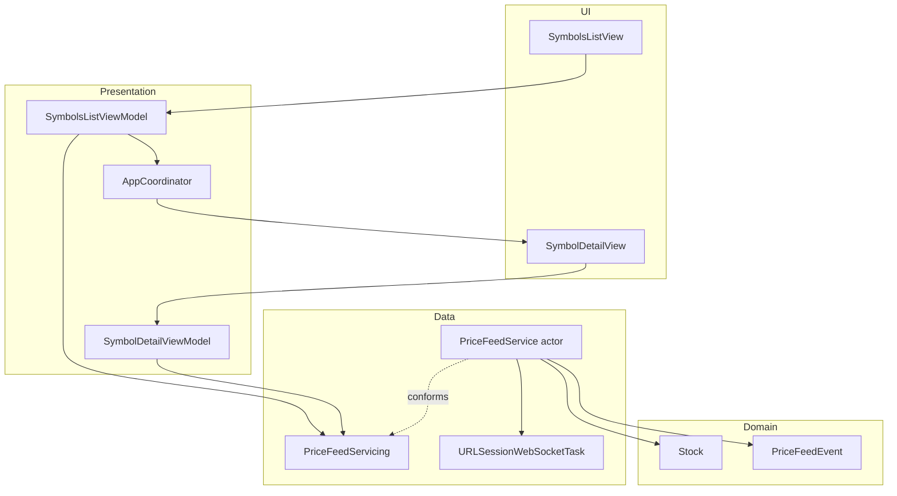
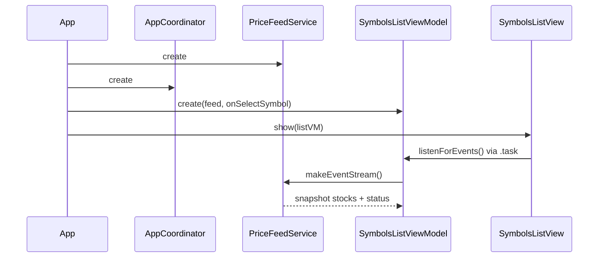
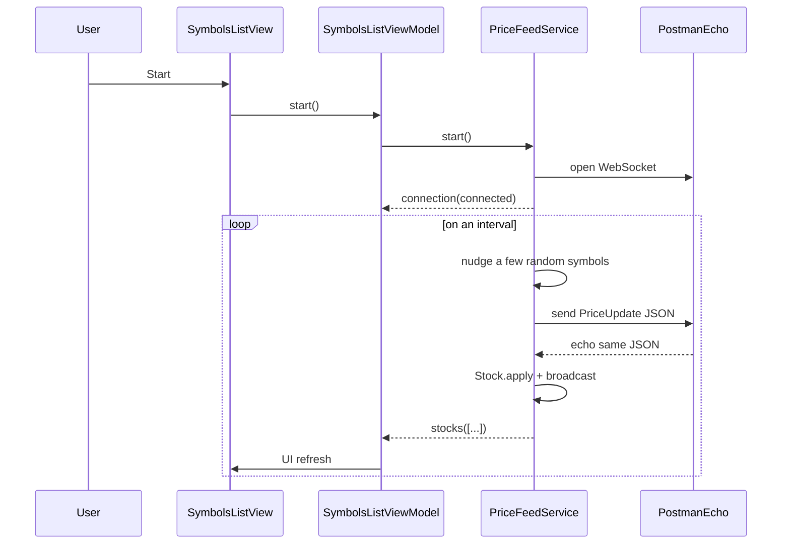
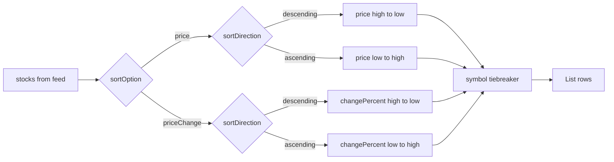
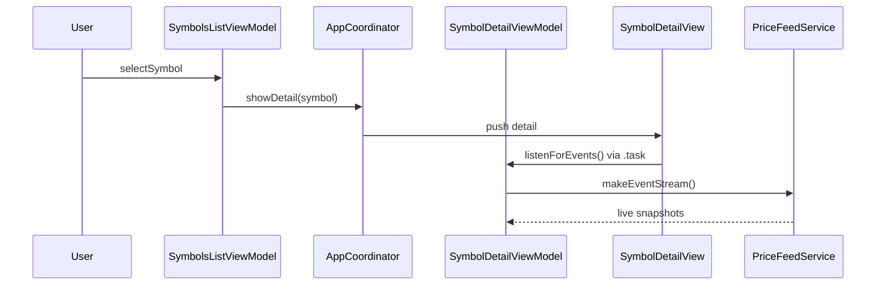

# Real-Time Stock Price Tracker

SwiftUI app that shows a watchlist of 25 symbols with live simulated prices over a WebSocket echo server, plus a detail screen per symbol.

Stack: **SwiftUI**, **MVVM**, **Coordinator** navigation, **async/await**, and an **`actor`**-based price feed. Unit tests use **Swift Testing**.

> Prices are not from a market API. The assessment uses Postman Echo (`wss://ws.postman-echo.com/raw`): the app generates random updates, sends them, and applies prices when the echo returns.

---

## Requirements

- Xcode 26.x (deployment target iOS 26.2)
- iOS Simulator or device
- Network access for the echo WebSocket

---

## Setup

1. Clone this repository.
2. Open `multibankgroup-stocks.xcodeproj` in Xcode.
3. Select the `multibankgroup-stocks` scheme and a simulator.
4. Run with ⌘R.

### Tests

Product → Test (⌘U), or:

```bash
xcodebuild test \
  -scheme multibankgroup-stocks \
  -destination 'platform=iOS Simulator,name=iPhone 17 Pro'
```

Use any installed simulator name in the destination string.

---

## Features

- 25 scrollable symbols: name, price, percent change
- Start / Stop WebSocket feed with connection status
- Sort by price or price change; tap again to toggle ascending / descending
- Detail screen: symbol title, live price, same change indicator, description
- List and detail stay in sync while the feed runs

---

## Architecture

MVVM + Coordinator, with the feed behind protocols so screens stay testable and easy to extend.



### Design choices

| Choice | Reason |
|--------|--------|
| **MVVM** | Screen logic in ViewModels; Views stay declarative. |
| **Coordinator** | Navigation in one place (`AppRoute` + `NavigationPath`). |
| **`StockQuoting` / `PriceFeedControlling`** | Interface segregation: detail only needs quotes; list also needs start/stop. |
| **`actor` price feed** | Serializes stock mutations across send/receive loops. ViewModels stay `@MainActor` and mirror events into UI state. |
| **`AsyncStream` events** | Feed stays UI-agnostic; each screen can subscribe independently. |
| **DTO vs domain** | `PriceUpdate` is wire JSON; `Stock` owns `apply` and derived change values. |
| **Local catalog** | No market API in the brief — symbols and seed prices are hardcoded. |

### Project layout

```
multibankgroup-stocks/
  App/           # Coordinator, routes
  Catalog/       # Seed watchlist (25 symbols)
  Models/        # Domain, DTOs, events
  Services/      # Feed protocols + WebSocket actor
  ViewModels/
  Views/
multibankgroup-stocksTests/
```

---

## Flows

### Launch

One feed and one coordinator live for the app lifetime. The list ViewModel is held in `@State` so pushing detail does not recreate the list.



### Live price updates



The UI updates **only after the echo** — that is what validates the WebSocket path.

### Sorting

Sorting is presentation state on the list ViewModel (`sortOption`, `sortDirection`, `sortedStocks`).

- First tap on a sort key selects it and uses **descending** (high → low).
- Tap the **same** key again to toggle **ascending** / **descending**.
- Tap the **other** key to switch metric and reset to descending.
- Ties break on symbol so equal values stay predictable.



### Detail navigation



List and detail each call `makeEventStream()`, so both can listen at the same time against one feed actor.

### Stop

Cancels the feed task group, closes the socket, and broadcasts `disconnected`. Last prices remain on screen until Start again.

---

## Testing

Swift Testing, no network calls.

| Suite | Coverage |
|-------|----------|
| `StockTests` | `apply`, change %, catalog size |
| `SymbolsListViewModelTests` | sorting, tiebreakers, start/stop, navigation callback |
| `SymbolDetailViewModelTests` | symbol selection and price updates via `consume` |
| `AppCoordinatorTests` | push / pop path |

ViewModels expose `consume(_:)` — the same path `listenForEvents()` uses — so tests drive events without timers. `FakePriceFeed` replaces the real actor.

---

## Assumptions

- Prices are simulated; Postman Echo only returns what the app sends.
- “Connected” means the local feed socket and loops are running.
